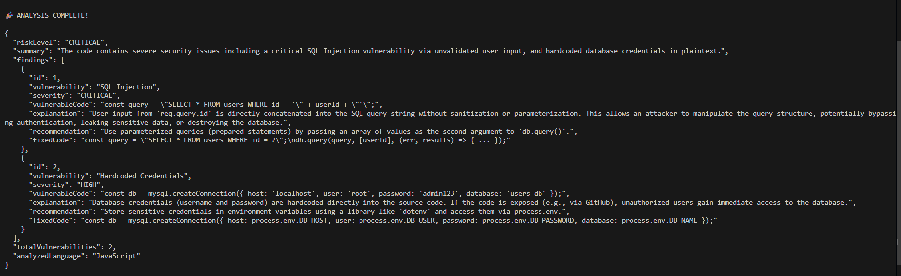
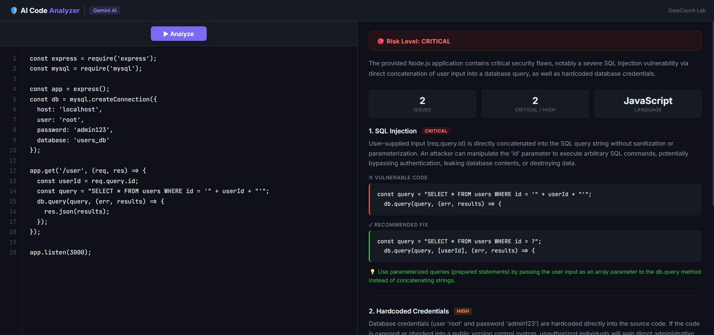

# 🛡️ Hands-On Lab: Building an AI-Powered Code Analyzer with Node.js

## Lab Title
**"Building Reliable AI Workflows with Node.js"**


## Table of Contents

1. [Introduction & Learning Objectives](#1-introduction--learning-objectives)
2. [Prerequisites](#2-prerequisites)
3. [Understanding the Architecture](#3-understanding-the-architecture)
4. [Step 1 — Project Setup & Dependencies](#step-1--project-setup--dependencies)
5. [Step 2 — Environment Configuration](#step-2--environment-configuration)
6. [Step 3 — Building the In-Memory Data Store](#step-3--building-the-in-memory-data-store)
7. [Step 4 — Integrating Google Gemini AI](#step-4--integrating-google-gemini-ai)
8. [Step 5 — Setting Up Inngest for Background Processing](#step-5--setting-up-inngest-for-background-processing)
9. [Step 6 — Creating the API Routes](#step-6--creating-the-api-routes)
10. [Step 7 — Wiring Up the Express Server](#step-7--wiring-up-the-express-server)
11. [Step 8 — Running & Testing the Application](#step-8--running--testing-the-application)
12. [Bonus — Building the Frontend UI](#bonus--building-the-frontend-ui)
13. [Verification & Final Testing](#verification--final-testing)
14. [Troubleshooting Guide](#troubleshooting-guide)
15. [Summary & Next Steps](#summary--next-steps)

---

## 1. Introduction & Learning Objectives

### The Problem

When you call an AI model (like Google Gemini or OpenAI), the response can take **10–30 seconds**. In a traditional synchronous API, the client sends a request and waits for the server to finish before getting a response. This creates two serious problems:

1. **HTTP Timeouts** — Platforms like Vercel, AWS Lambda, and Netlify enforce 10–30 second request limits. A slow AI call can exceed this limit and kill your request mid-flight.
2. **Blocked Users** — The user is frozen, staring at a loading screen, unable to interact with the app. If anything goes wrong, they have no idea why.

### The Solution

We solve this with an **event-driven, background processing** architecture:

1. The user submits code → The API responds **immediately** with a job ID (< 200ms).
2. A background worker picks up the job, calls the AI, and saves the result.
3. The frontend polls the status endpoint until the result is ready.

This pattern is used at scale by companies like GitHub (code scanning), Stripe (payment processing), and Vercel (build deployments).

### What You Will Learn

- ✅ How to build a REST API with **Express.js**
- ✅ How to integrate **Google Gemini AI** for code analysis
- ✅ How to use **Inngest** for background task processing with automatic retries
- ✅ How to design an **asynchronous job queue** architecture
- ✅ How to craft AI prompts that return **structured JSON** responses

---

## 2. Prerequisites

Before starting this lab, ensure you have the following installed and configured on your machine.

### Required Software

| Tool | Minimum Version | Check Command | Purpose |
|------|-----------------|---------------|---------|
| **Node.js** | v18 or higher | `node --version` | JavaScript runtime |
| **npm** | v9 or higher | `npm --version` | Package manager (comes with Node.js) |
| **Git** | Any recent version | `git --version` | Version control |
| **Code Editor** | — | — | VS Code recommended |
| **Web Browser** | — | — | Chrome or Firefox recommended |

### Required Accounts

| Service | Why | Sign-Up Link |
|---------|-----|-------------|
| **Google AI Studio** | To get a free Gemini API key | [aistudio.google.com/app/apikey](https://aistudio.google.com/app/apikey) |

> **⚠️ Important:** Get your Gemini API key **before** starting the lab. It's free and takes 30 seconds. You'll need it in Step 2.

### Verify Your Setup

Open your terminal and run:

```bash
node --version    # Should output v18.x.x or higher
npm --version     # Should output v9.x.x or higher
```


---

## 3. Understanding the Architecture

Before we write any code, let's understand what we're building:



### Key Components

| File | Role | Analogy |
|------|------|---------|
| `server.js` | Main entry point — sets up Express + Inngest | The "front desk" |
| `routes/analyze.js` | API endpoints (submit code, check status) | The "receptionist" taking orders |
| `inngest/functions.js` | Background worker that calls the AI | The "kitchen" doing the real work |
| `services/geminiService.js` | Communicates with Google Gemini AI | The "chef" who does the cooking |
| `store/resultsStore.js` | In-memory job storage | The "order board" tracking status |

### Data Flow (Step-by-Step)

1. **User submits code** → `POST /api/analyze`
2. **API generates a unique job ID** and saves status as `"queued"`
3. **API triggers an Inngest event** called `"analyze.code"`
4. **API returns the job ID immediately** (user isn't waiting for AI!)
5. **Inngest picks up the event** and runs the background function
6. **Background function calls Gemini AI** with the code snippet
7. **AI returns analysis** → result is saved as `"completed"`
8. **Frontend polls** `GET /api/status/:jobId` every 2 seconds until done

---

## Step 1 — Project Setup & Dependencies

### 1.1 Create the Project Folder

```bash
mkdir ai-code-analyzer
cd ai-code-analyzer
```

### 1.2 Initialize the Node.js Project

```bash
npm init -y
```

> **Why?** `npm init -y` creates a `package.json` file, which is the manifest for your project. It tracks your app's name, version, scripts, and dependencies. The `-y` flag accepts all defaults so you don't have to answer interactive prompts.

### 1.3 Install Dependencies

```bash
npm install express cors dotenv inngest
```

| Package | Purpose |
|---------|---------|
| `express` | Web framework — handles HTTP requests and routing |
| `cors` | Enables cross-origin requests from the frontend |
| `dotenv` | Loads environment variables from a `.env` file (keeps secrets out of code!) |
| `inngest` | Event-driven background task runner with automatic retries |

> **Key Insight:** Notice we are **not** installing `@google/generative-ai` or any Gemini SDK. We'll use Node.js's built-in `fetch` API to call Gemini directly via REST. This keeps dependencies minimal and teaches you how API calls actually work under the hood.

### 1.4 Create the Folder Structure

```bash
mkdir -p src/routes src/services src/inngest src/store src/samples src/test public
```

Your project should now look like this:

```
ai-code-analyzer/
├── package.json
├── public/           ← Frontend HTML/CSS/JS
└── src/
    ├── routes/       ← API endpoint definitions
    ├── services/     ← AI integration logic
    ├── inngest/      ← Background function definitions
    ├── store/        ← In-memory data storage
    ├── samples/      ← Test code snippets
    └── test/         ← Test scripts
```


### 1.5 Add npm Scripts

Open `package.json` and update the `"scripts"` section:

```json
"scripts": {
  "dev": "node src/server.js",
  "start": "node src/server.js",
  "inngest-dev": "npx inngest-cli@latest dev -u http://localhost:3000/api/inngest",
  "test": "node src/test/testAnalyzer.js"
}
```

> **Why two scripts for running?** We need **two terminals** running simultaneously — one for the Express server (`npm run dev`) and one for the Inngest dev server (`npm run inngest-dev`). The Inngest dev server acts as the local event broker that receives events from your app and dispatches them to your background functions.

---

## Step 2 — Environment Configuration

### 2.1 Create the `.env` File

Create a file named `.env` in the project root:

```env
# ============================================
# AI-Powered Code Analyzer - Environment Config
# ============================================

# Your Google Gemini API Key
# Get it free at: https://aistudio.google.com/app/apikey
GEMINI_API_KEY=paste-your-actual-key-here

# Server Configuration
PORT=3000

# Inngest Configuration (uses local dev server by default)
INNGEST_DEV=1
INNGEST_EVENT_KEY=local-dev-key
```

> **Why a `.env` file?** Hardcoding API keys in source code is a critical security vulnerability (exactly the kind our analyzer will catch!). The `.env` file keeps secrets separate from code. The `dotenv` package loads these values into `process.env` at runtime.

### 2.2 Create `.gitignore`

Create a `.gitignore` file to ensure secrets are never committed:

```
node_modules/
.env
```

> **⚠️ Critical:** NEVER commit your `.env` file to Git. If you push your API key to GitHub, bots will find it within minutes and abuse it.


---

## Step 3 — Building the In-Memory Data Store

**File:** `src/store/resultsStore.js`

Before we connect to AI or build routes, we need somewhere to store job statuses and results. In production, you'd use a database like MongoDB or PostgreSQL. For this lab, we use a JavaScript `Map` — a simple key-value store that lives in server memory.

```javascript
// ============================================
// resultsStore.js — In-Memory Results Storage
// ============================================
// This module acts as a simple in-memory database to store
// the results of our AI code analysis jobs. In a production app,
// you'd use a real database (e.g., MongoDB, PostgreSQL).
//
// WHY IN-MEMORY? For this lab, we keep things simple so students
// can focus on the AI workflow, not database setup.
// ============================================

// A JavaScript Map to store analysis results, keyed by job ID
const results = new Map();

/**
 * Save an analysis result to the store.
 * @param {string} jobId - The unique identifier for the analysis job
 * @param {object} data - The analysis result data to store
 */
function saveResult(jobId, data) {
  results.set(jobId, {
    ...data,
    updatedAt: new Date().toISOString(),
  });
}

/**
 * Retrieve an analysis result from the store.
 * @param {string} jobId - The unique identifier for the analysis job
 * @returns {object|null} The stored result, or null if not found
 */
function getResult(jobId) {
  return results.get(jobId) || null;
}

/**
 * Get all stored results (useful for debugging).
 * @returns {Array} Array of all stored results
 */
function getAllResults() {
  return Array.from(results.entries()).map(([id, data]) => ({
    jobId: id,
    ...data,
  }));
}

// Export functions so other modules can use them
module.exports = { saveResult, getResult, getAllResults };
```

### Conceptual Explanation

- **`saveResult(jobId, data)`** — Creates or updates a job record. We use the spread operator (`...data`) so we can save partial updates (like just changing the status from "queued" to "processing") without overwriting other fields.
- **`getResult(jobId)`** — Looks up a job by ID. Returns `null` if the job doesn't exist.
- **`getAllResults()`** — Returns every stored job. We'll use this in a debug endpoint later.

> **Design Decision:** Why `Map` instead of a plain object? Maps preserve insertion order, have better performance for frequent additions/deletions, and have a clean `.get()` / `.set()` API. They're the right choice for a key-value store.

---

## Step 4 — Integrating Google Gemini AI

**File:** `src/services/geminiService.js`

This is the brain of our application. It takes a code snippet, constructs a carefully crafted prompt, sends it to Google Gemini, and parses the structured JSON response.

```javascript
// ============================================
// geminiService.js — Google Gemini AI Integration
// ============================================
// This module handles all communication with Google's Gemini AI.
// It sends a code snippet to Gemini and asks it to analyze the code
// for security vulnerabilities, returning a structured JSON response.
//
// WHY A SEPARATE SERVICE? Keeping AI logic in its own file follows
// the "Separation of Concerns" principle — each file has one job.
// ============================================

require("dotenv").config();

// --- Configuration ---
const GEMINI_API_KEY = process.env.GEMINI_API_KEY;
const GEMINI_MODEL = "gemini-2.0-flash-lite";
const GEMINI_API_URL = `https://generativelanguage.googleapis.com/v1beta/models/${GEMINI_MODEL}:generateContent`;

/**
 * Analyze a code snippet for security vulnerabilities using Gemini AI.
 * Includes automatic retry (up to 3 times) if Gemini is busy.
 *
 * @param {string} codeSnippet - The code to analyze
 * @param {string} language - The programming language (or "auto" to auto-detect)
 * @returns {object} Structured analysis result with riskLevel and findings
 */
async function analyzeCode(codeSnippet, language = "auto") {
  // --- Step 1: Craft the AI Prompt ---
  const langInstruction = language === "auto"
    ? "First, detect the programming language of the code below."
    : `The code is written in ${language}.`;

  const prompt = `
You are an expert code security analyst. ${langInstruction} Analyze the following code snippet for security vulnerabilities.

**CODE TO ANALYZE:**
\`\`\`
${codeSnippet}
\`\`\`

**INSTRUCTIONS:**
1. Detect the programming language if not specified.
2. Identify ALL security vulnerabilities in the code.
3. For each vulnerability, provide:
   - The type of vulnerability (e.g., "SQL Injection", "XSS", "Hardcoded Credentials")
   - The specific line or section of code that is vulnerable
   - A severity rating: "CRITICAL", "HIGH", "MEDIUM", or "LOW"
   - A clear explanation of WHY it's a vulnerability
   - A recommended fix with a corrected code example
4. Assign an overall risk level: "CRITICAL", "HIGH", "MEDIUM", "LOW", or "SAFE"
5. If the code has no vulnerabilities, set riskLevel to "SAFE" and return an empty findings array.

**YOU MUST RESPOND IN THIS EXACT JSON FORMAT AND NOTHING ELSE:**
{
  "riskLevel": "HIGH",
  "summary": "Brief overall summary of the security analysis",
  "findings": [
    {
      "id": 1,
      "vulnerability": "Name of the vulnerability",
      "severity": "CRITICAL|HIGH|MEDIUM|LOW",
      "vulnerableCode": "the problematic code snippet",
      "explanation": "Why this is a security risk",
      "recommendation": "How to fix it",
      "fixedCode": "the corrected code snippet"
    }
  ],
  "totalVulnerabilities": 1,
  "analyzedLanguage": "detected language name (e.g. JavaScript, Python, Java)"
}

IMPORTANT: Return ONLY valid JSON. No markdown, no code fences, no extra text.
`;

  // --- Step 2: Send to Gemini with Retry Logic ---
  const MAX_RETRIES = 3;
  let lastError = null;

  for (let attempt = 1; attempt <= MAX_RETRIES; attempt++) {
    try {
      console.log(`🤖 Sending code to Gemini AI (attempt ${attempt}/${MAX_RETRIES})...`);

      const response = await fetch(`${GEMINI_API_URL}?key=${GEMINI_API_KEY}`, {
        method: "POST",
        headers: { "Content-Type": "application/json" },
        body: JSON.stringify({
          contents: [{ parts: [{ text: prompt }] }],
        }),
      });

      const data = await response.json();

      // --- Check for API Errors ---
      if (data.error) {
        const isBusy = data.error.message.includes("high demand") ||
                       response.status === 429 || response.status === 503;

        if (isBusy && attempt < MAX_RETRIES) {
          console.log(`⏳ Gemini is busy. Waiting 5 seconds before retry...`);
          await new Promise(resolve => setTimeout(resolve, 5000));
          continue;
        }
        throw new Error(`Gemini API error: ${data.error.message}`);
      }

      // --- Extract the Response Text ---
      const text = data.candidates?.[0]?.content?.parts?.[0]?.text;

      if (!text) {
        throw new Error("Gemini returned an empty response");
      }

      // --- Parse the JSON Response ---
      const cleanedText = text
        .replace(/```json\n?/g, "")
        .replace(/```\n?/g, "")
        .trim();

      const analysisResult = JSON.parse(cleanedText);

      console.log("✅ Gemini analysis complete!");
      return analysisResult;

    } catch (error) {
      lastError = error;
      console.error(`❌ Attempt ${attempt} failed:`, error.message);

      if (attempt < MAX_RETRIES && !error.message.includes("API_KEY")) {
        console.log(`⏳ Waiting 3 seconds before retry...`);
        await new Promise(resolve => setTimeout(resolve, 3000));
        continue;
      }
    }
  }

  // --- All retries exhausted ---
  throw new Error(`AI analysis failed after ${MAX_RETRIES} attempts: ${lastError?.message}`);
}

// Export the function so other modules can use it
module.exports = { analyzeCode };
```

### Conceptual Explanation

**Prompt Engineering** is the most critical part of this file. Notice how the prompt:
- Defines a **role** ("You are an expert code security analyst")
- Provides **exact JSON structure** the AI must follow
- Ends with a **strict constraint** ("Return ONLY valid JSON")

This forces the AI to return predictable, parseable data rather than free-form text.

**Retry Logic** is essential because AI APIs are shared resources. During peak usage, Gemini may return a 429 (rate limit) or 503 (overloaded) error. Our code automatically waits and retries up to 3 times before giving up.

**Response Cleaning** (the `replace` calls) handles cases where the AI wraps its JSON in markdown code fences (` ```json ... ``` `) despite being told not to. LLMs don't always follow instructions perfectly, so we clean up defensively.


---

## Step 5 — Setting Up Inngest for Background Processing

### 5.1 Create the Inngest Client

**File:** `src/inngest/client.js`

```javascript
// ============================================
// client.js — Inngest Client Initialization
// ============================================
// Inngest is an event-driven task runner that lets us process
// long-running tasks (like AI calls) in the background.
//
// WHY INNGEST? When we call an AI model, it can take 10-30 seconds
// to respond. If we do this inside a normal API request, the request
// might timeout (especially on serverless platforms like Vercel).
// Inngest solves this by:
//   1. Accepting an event (trigger)
//   2. Running the AI call in the background
//   3. Automatically retrying if something fails
// ============================================

const { Inngest } = require("inngest");

// Create and configure the Inngest client
// The "id" is a unique name for your app in Inngest's system
const inngest = new Inngest({
  id: "ai-code-analyzer",
  eventKey: process.env.INNGEST_EVENT_KEY || "local-dev-key",
});

// Export the client so other files can use it to send events
// and define functions
module.exports = { inngest };
```

### 5.2 Create the Background Analysis Function

**File:** `src/inngest/functions.js`

This is the **background worker** — the function that Inngest runs whenever an `"analyze.code"` event is received.

```javascript
// ============================================
// functions.js — Inngest Background Functions
// ============================================
// This file defines the background functions that Inngest will run.
// Think of each function as a "worker" that processes a specific type of job.
//
// FLOW:
// 1. User submits code via API → triggers an "analyze.code" event
// 2. Inngest picks up the event and runs this function in the background
// 3. This function calls Gemini AI to analyze the code
// 4. The result is saved to our results store
// 5. The user can check the status/result anytime via the status endpoint
// ============================================

const { inngest } = require("./client");
const { analyzeCode } = require("../services/geminiService");
const { saveResult } = require("../store/resultsStore");

// --- Define the Code Analysis Background Function ---
const analyzeCodeFunction = inngest.createFunction(
  {
    id: "analyze-code-vulnerability",
    name: "Analyze Code for Vulnerabilities",
    retries: 3,
    triggers: [{ event: "analyze.code" }],
  },
  async ({ event, step }) => {
    const { jobId, codeSnippet, language } = event.data;

    console.log(`\n📋 Job ${jobId}: Starting analysis...`);
    console.log(`   Language: ${language === 'auto' ? 'Auto-detect' : language}`);
    console.log(`   Code length: ${codeSnippet.length} characters\n`);

    try {
      // --- Step 1: Update Status to "processing" ---
      await step.run("update-status-processing", async () => {
        saveResult(jobId, {
          status: "processing",
          message: "AI is analyzing your code...",
          submittedAt: event.data.submittedAt,
        });
        console.log(`📋 Job ${jobId}: Status updated to "processing"`);
      });

      // --- Step 2: Call Gemini AI for Analysis ---
      const analysisResult = await step.run("call-gemini-ai", async () => {
        console.log(`🤖 Job ${jobId}: Calling Gemini AI...`);
        const result = await analyzeCode(codeSnippet, language);
        console.log(`✅ Job ${jobId}: AI analysis received!`);
        return result;
      });

      // --- Step 3: Save the Final Result ---
      await step.run("save-analysis-result", async () => {
        saveResult(jobId, {
          status: "completed",
          submittedAt: event.data.submittedAt,
          completedAt: new Date().toISOString(),
          language: language,
          codeSnippet: codeSnippet,
          analysis: analysisResult,
        });
        console.log(`✅ Job ${jobId}: Analysis complete and saved!`);
      });

      return {
        jobId,
        status: "completed",
        riskLevel: analysisResult.riskLevel,
        totalVulnerabilities: analysisResult.totalVulnerabilities,
      };
    } catch (error) {
      console.error(`❌ Job ${jobId}: Analysis failed!`, error.message);
      saveResult(jobId, {
        status: "failed",
        error: error.message,
        submittedAt: event.data.submittedAt,
        failedAt: new Date().toISOString(),
      });
      throw error;
    }
  }
);

module.exports = { analyzeCodeFunction };
```

### Conceptual Explanation

**Why `step.run()`?** Each `step.run()` block is an **atomic unit of work** that Inngest tracks independently. If Step 2 (the AI call) fails but Step 1 (status update) succeeded, Inngest will only retry Step 2 — it won't re-run Step 1. This is called **durable execution** and prevents duplicate work.

**Why `retries: 3`?** AI APIs are unreliable. Network glitches, rate limits, and server overloads happen regularly. Automatic retries ensure transient failures don't become permanent failures.

---

## Step 6 — Creating the API Routes

**File:** `src/routes/analyze.js`

This file defines the HTTP endpoints that the frontend (and any API client) will interact with.

```javascript
// ============================================
// analyze.js — API Routes for Code Analysis
// ============================================
// ENDPOINTS:
//   POST /api/analyze    → Submit code for analysis (returns a jobId)
//   GET  /api/status/:id → Check the status/result of a job
//   GET  /api/jobs       → List all analysis jobs (for debugging)
// ============================================

const express = require("express");
const crypto = require("crypto");
const { inngest } = require("../inngest/client");
const { saveResult, getResult, getAllResults } = require("../store/resultsStore");

const router = express.Router();

// ============================================
// POST /api/analyze — Submit Code for Analysis
// ============================================
router.post("/analyze", async (req, res) => {
  try {
    // --- Step 1: Validate the Request ---
    const { code, language } = req.body;

    if (!code || typeof code !== "string" || code.trim().length === 0) {
      return res.status(400).json({
        success: false,
        error: "Missing or empty 'code' field. Please provide a code snippet to analyze.",
      });
    }

    // --- Step 2: Generate a Unique Job ID ---
    const jobId = crypto.randomUUID();
    const submittedAt = new Date().toISOString();

    // --- Step 3: Save Initial Job Status ---
    saveResult(jobId, {
      status: "queued",
      message: "Job received and queued for processing",
      submittedAt: submittedAt,
      language: language || "auto",
    });

    // --- Step 4: Trigger the Inngest Background Event ---
    await inngest.send({
      name: "analyze.code",
      data: {
        jobId: jobId,
        codeSnippet: code,
        language: language || "auto",
        submittedAt: submittedAt,
      },
    });

    console.log(`\n🚀 New analysis job submitted: ${jobId}`);

    // --- Step 5: Return the Job ID Immediately ---
    res.status(202).json({
      success: true,
      jobId: jobId,
      status: "queued",
      message: `Analysis job submitted! Check status at /api/status/${jobId}`,
      statusUrl: `/api/status/${jobId}`,
    });
  } catch (error) {
    console.error("❌ Failed to submit analysis job:", error.message);
    res.status(500).json({
      success: false,
      error: "Failed to submit analysis job. Please try again.",
    });
  }
});

// ============================================
// GET /api/status/:jobId — Check Job Status
// ============================================
router.get("/status/:jobId", (req, res) => {
  const { jobId } = req.params;
  const result = getResult(jobId);

  if (!result) {
    return res.status(404).json({
      success: false,
      error: `No job found with ID: ${jobId}`,
    });
  }

  res.status(200).json({
    success: true,
    jobId: jobId,
    ...result,
  });
});

// ============================================
// GET /api/jobs — List All Jobs (Debug)
// ============================================
router.get("/jobs", (req, res) => {
  const allJobs = getAllResults();
  res.status(200).json({
    success: true,
    totalJobs: allJobs.length,
    jobs: allJobs,
  });
});

module.exports = router;
```

### Conceptual Explanation

**HTTP Status 202 (Accepted)** — We return 202 instead of the typical 200 (OK). Why? Status 202 means "I've accepted your request, but it's not done yet." This is semantically correct for asynchronous operations and is a REST API best practice.

**`crypto.randomUUID()`** — Node.js has a built-in UUID generator since v14.17. No external package needed! Each UUID is globally unique (the chance of collision is 1 in 2¹²² — effectively impossible).

**Polling Pattern** — The frontend will call `GET /api/status/:jobId` every 2 seconds until the status changes to `"completed"` or `"failed"`. This is simple, reliable, and works everywhere.

---

## Step 7 — Wiring Up the Express Server

**File:** `src/server.js`

This is the main entry point that ties everything together.

```javascript
// ============================================
// server.js — Main Application Entry Point
// ============================================

const express = require("express");
const cors = require("cors");
const path = require("path");
const { serve } = require("inngest/express");
require("dotenv").config();

// --- Import Our Modules ---
const { inngest } = require("./inngest/client");
const { analyzeCodeFunction } = require("./inngest/functions");
const analyzeRoutes = require("./routes/analyze");

// --- Initialize Express App ---
const app = express();
const PORT = process.env.PORT || 3000;

// ============================================
// Middleware Setup
// ============================================

// cors() — Allows requests from other domains
app.use(cors());

// express.json() — Parses incoming JSON request bodies
app.use(express.json({ limit: "10mb" }));

// --- Request Logger Middleware ---
app.use((req, res, next) => {
  if (req.path.includes('inngest') || req.path.includes('.netlify') || req.path.includes('.redwood') || req.path === '/x/inngest') {
    return next();
  }
  console.log(`📨 ${req.method} ${req.path}`);
  next();
});

// ============================================
// Static Files & Route Registration
// ============================================

// Serve the Frontend from /public
app.use(express.static(path.join(__dirname, "..", "public")));

// Health Check Endpoint
app.get("/api/health", (req, res) => {
  res.json({
    name: "AI-Powered Code Analyzer",
    version: "1.0.0",
    status: "running",
  });
});

// Mount the Analysis Routes at /api
app.use("/api", analyzeRoutes);

// Inngest Serve Endpoint
app.use(
  "/api/inngest",
  serve({
    client: inngest,
    functions: [analyzeCodeFunction],
  })
);

// ============================================
// Error Handling Middleware
// ============================================
app.use((err, req, res, next) => {
  console.error("💥 Unhandled Error:", err.message);
  res.status(500).json({
    success: false,
    error: "Internal server error",
    message: err.message,
  });
});

// ============================================
// Start the Server
// ============================================
app.listen(PORT, () => {
  console.log(`\n  🛡️  AI-Powered Code Analyzer`);
  console.log(`  Server running on http://localhost:${PORT}`);
  console.log(`  Frontend:  http://localhost:${PORT}`);
  console.log(`  API:       http://localhost:${PORT}/api\n`);
});

module.exports = app;
```

### Conceptual Explanation

**Middleware Order Matters!** Express processes middleware in the order it's registered:
1. `cors()` runs first — allows cross-origin requests
2. `express.json()` parses request bodies
3. Our logger logs each request
4. Static files serve the frontend
5. API routes handle business logic
6. Error handler catches anything that went wrong

**`serve()` from Inngest** creates a special endpoint at `/api/inngest` that the Inngest Dev Server communicates with. It handles function registration, event dispatch, and health checks automatically.

---

## Step 8 — Running & Testing the Application

### 8.1 Start the Express Server

Open **Terminal 1** and run:

```bash
npm run dev
```

You should see:

```
  🛡️  AI-Powered Code Analyzer
  Server running on http://localhost:3000
  Frontend:  http://localhost:3000
  API:       http://localhost:3000/api
```


### 8.2 Start the Inngest Dev Server

Open **Terminal 2** (keep Terminal 1 running!) and run:

```bash
npm run inngest-dev
```

You should see:

```
Inngest Dev Server online at 0.0.0.0:8288, visible at the following URLs:
  - http://localhost:8288
```


> **⚠️ Both terminals must be running simultaneously.** The Express server handles HTTP requests, while the Inngest dev server handles background event processing. If Inngest isn't running, jobs will be submitted but never processed.

### 8.3 Test the Health Endpoint

Open your browser and visit: **http://localhost:3000/api/health**

You should see a JSON response confirming the server is running.


### 8.4 Test with a Code Snippet

Create a test script at `src/test/testAnalyzer.js`:

```javascript
// ============================================
// testAnalyzer.js — Quick Test Script
// ============================================
// USAGE: node src/test/testAnalyzer.js
// (Make sure the server AND Inngest dev server are running first!)
// ============================================

async function testAnalyzer() {
  console.log("🧪 Testing AI-Powered Code Analyzer\n");

  const testCode = `
const query = "SELECT * FROM users WHERE id = '" + userId + "'";
db.query(query);
  `.trim();

  try {
    // Step 1: Submit the code
    const submitRes = await fetch("http://localhost:3000/api/analyze", {
      method: "POST",
      headers: { "Content-Type": "application/json" },
      body: JSON.stringify({ code: testCode }),
    });

    const submitData = await submitRes.json();
    console.log("✅ Job submitted:", submitData.jobId);

    // Step 2: Poll for the result
    console.log("⏳ Waiting for AI analysis...\n");

    let attempts = 0;
    while (attempts < 20) {
      await new Promise(r => setTimeout(r, 3000));
      attempts++;

      const statusRes = await fetch(
        `http://localhost:3000/api/status/${submitData.jobId}`
      );
      const statusData = await statusRes.json();

      console.log(`   Attempt ${attempts}: ${statusData.status}`);

      if (statusData.status === "completed") {
        console.log("\n🎉 ANALYSIS COMPLETE!\n");
        console.log(JSON.stringify(statusData.analysis, null, 2));
        return;
      }

      if (statusData.status === "failed") {
        console.error("\n❌ Analysis failed:", statusData.error);
        return;
      }
    }

    console.log("\n⚠️ Timeout — check server logs.");
  } catch (error) {
    console.error("❌ Error:", error.message);
    console.log("💡 Make sure both servers are running!");
  }
}

testAnalyzer();
```

Run it with both servers active:

```bash
npm test
```



---

## Bonus — Building the Frontend UI (Extra Credit)

> **This step is optional.** The assignment only requires the backend API and source code. We built a frontend UI as an extra feature to make testing more interactive.

**File:** `public/index.html`

The frontend is a single-page application with a split-panel layout:
- **Left panel:** Code editor with line numbers and the Analyze button
- **Right panel:** Results display with vulnerability cards, severity badges, and fix suggestions

The frontend uses:
- **Vanilla HTML/CSS/JS** — no frameworks needed
- **Dynamic line numbers** that sync with the code editor
- **Polling** to check analysis status every 2 seconds
- **Sample vulnerability buttons** to quickly test different attack types

> **Note:** The complete frontend code is provided in the reference source code (`public/index.html`). It's ~600 lines of HTML/CSS/JS that creates a professional dark-themed code analysis interface. The key JavaScript logic is the `analyzeCode()` function that:
> 1. Sends the code to `POST /api/analyze`
> 2. Receives a job ID
> 3. Polls `GET /api/status/:jobId` every 2 seconds
> 4. Renders the results when the status becomes "completed"



---

## Verification & Final Testing

### ✅ Checklist

Use this checklist to verify your application is fully working:

| # | Test | Expected Result | Status |
|---|------|-----------------|--------|
| 1 | Visit `http://localhost:3000` | Frontend UI loads | ☐ |
| 2 | Visit `http://localhost:3000/api/health` | JSON health response | ☐ |
| 3 | Click "SQL Injection" sample button | Code loads into editor | ☐ |
| 4 | Click "▶ Analyze" | Loading spinner appears, button shows "Analyzing..." | ☐ |
| 5 | Wait 5-10 seconds | Results appear with risk level, findings, and fix suggestions | ☐ |
| 6 | Check Terminal 1 | Shows job submission and completion logs | ☐ |
| 7 | Check Terminal 2 | Shows Inngest function execution | ☐ |
| 8 | Try "Safe Code" sample | Should return "SAFE" risk level with no findings | ☐ |
| 9 | Run `npm test` | Test script completes with JSON analysis output | ☐ |
| 10 | Visit `http://localhost:3000/api/jobs` | Lists all submitted jobs | ☐ |


### Sample Expected Output

When analyzing a SQL Injection vulnerability, the AI should return something like:

```json
{
  "riskLevel": "CRITICAL",
  "summary": "Critical SQL injection and hardcoded credentials detected",
  "findings": [
    {
      "id": 1,
      "vulnerability": "SQL Injection",
      "severity": "CRITICAL",
      "vulnerableCode": "const query = \"SELECT * FROM users WHERE id = '\" + userId + \"'\"",
      "explanation": "User input is directly concatenated into the SQL query without sanitization, allowing attackers to inject malicious SQL commands.",
      "recommendation": "Use parameterized queries instead of string concatenation.",
      "fixedCode": "const query = \"SELECT * FROM users WHERE id = ?\"; db.query(query, [userId]);"
    }
  ],
  "totalVulnerabilities": 1,
  "analyzedLanguage": "JavaScript"
}
```

---

## Troubleshooting Guide

### Common Error 1: "Gemini API error: API key not valid"

**Symptoms:** The analysis job fails immediately. Terminal shows:
```
❌ Attempt 1 failed: Gemini API error: API key not valid. Please pass a valid API key.
```

**Cause:** Your `GEMINI_API_KEY` in `.env` is missing, incorrect, or has been revoked.

**Fix:**
1. Open `.env` and check that `GEMINI_API_KEY` has your actual key (no quotes needed).
2. Verify the key at [aistudio.google.com/app/apikey](https://aistudio.google.com/app/apikey).
3. Restart the server after updating `.env`:
   ```bash
   # Press Ctrl+C to stop the server, then:
   npm run dev
   ```

---

### Common Error 2: "Analysis job submitted but never completes (stuck on 'processing')"

**Symptoms:** The frontend shows the loading spinner forever. Terminal 1 shows the job was submitted, but no AI analysis logs appear.

**Cause:** The Inngest Dev Server is not running. Without it, events are sent but never picked up.

**Fix:**
1. Make sure **Terminal 2** is running `npm run inngest-dev`.
2. If it crashed, restart it:
   ```bash
   npm run inngest-dev
   ```
3. Check the Inngest dashboard at **http://localhost:8288** to see if events are being received.


---

### Common Error 3: "Port 3000 already in use"

**Symptoms:**
```
Error: listen EADDRINUSE: address already in use :::3000
```

**Fix:** Another process is using port 3000. Either:
- Stop the other process, or
- Change the port in `.env`:
  ```
  PORT=3001
  ```

---

## Summary & Next Steps

### What You Built

You successfully built an **AI-Powered Code Analyzer** with:

- ✅ A **REST API** that accepts code snippets and returns structured vulnerability reports
- ✅ **Background processing** with Inngest — no HTTP timeouts, automatic retries
- ✅ **Google Gemini AI** integration with prompt engineering for reliable JSON output
- ✅ A **polling-based frontend** that tracks job status in real time
- ✅ **Auto language detection** — the AI identifies the programming language automatically

### Key Architectural Takeaways

1. **Never block the main thread** with slow AI calls. Use background processing.
2. **Prompt engineering** is as important as the code. A well-structured prompt = reliable output.
3. **Retry logic** is essential for production AI apps. APIs fail — your app shouldn't.
4. **Separation of concerns** makes code maintainable. Each file has one clear responsibility.

### Production Enhancements

If you were to deploy this in production, you would add:

| Enhancement | Why |
|-------------|-----|
| A real database (PostgreSQL, MongoDB) | In-memory store loses data on restart |
| Authentication (JWT, API keys) | Prevent unauthorized access |
| Rate limiting | Prevent abuse and control AI costs |
| WebSocket or SSE | Replace polling with real-time push updates |
| Input sanitization | Prevent prompt injection attacks |
| Docker containerization | Consistent deployment across environments |

---

